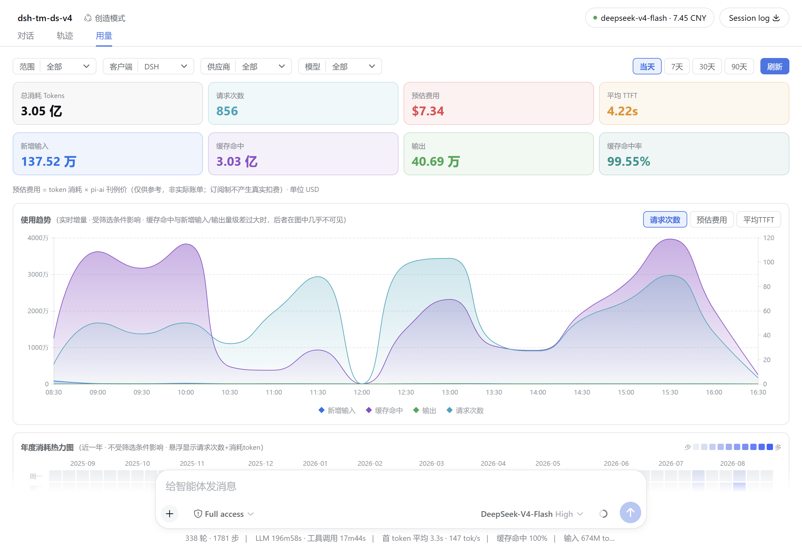
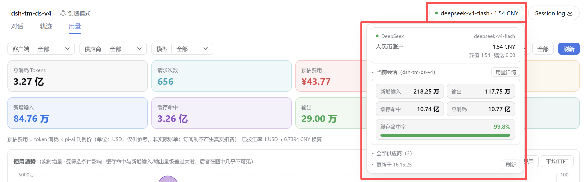
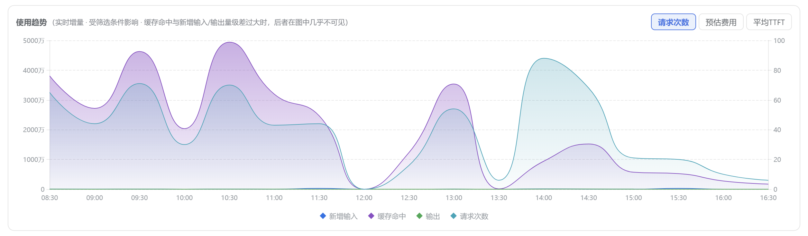
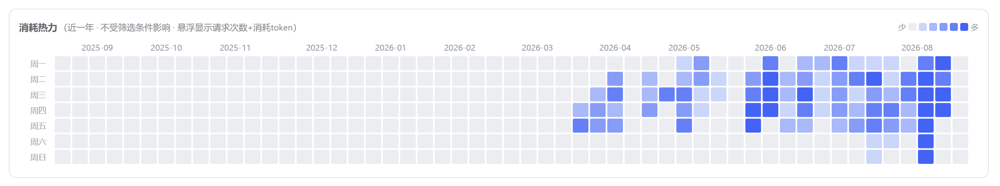
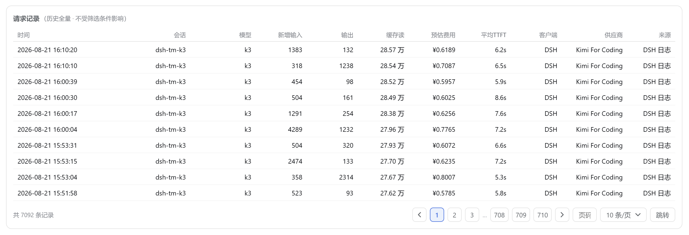
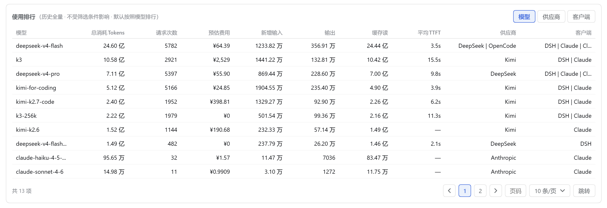
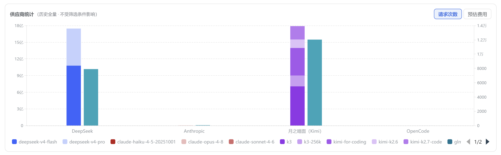
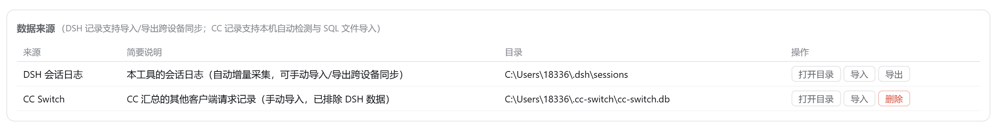

<div align="center">

# dsh-token-monitor

<a href="https://www.npmjs.com/package/dsh-token-monitor" target="_blank" rel="noopener noreferrer"></a>
[](https://github.com/licyer/dsh-token-monitor/releases)
[](LICENSE)
[](https://github.com/deepseek-ai/deepseek-harness)
[](https://nodejs.org)

[安装](#安装) · [功能](#功能) · [插件配置](#插件配置) · [供应商适配](#供应商适配) · [常见问题](#常见问题) · [设计](#设计) · [开发](#开发)

</div>

DeepSeek Harness（DSH）Web 界面的大模型**余量与用量监控**插件：会话头部实时余量徽标 + 主区"用量"页签，本地 SQLite 记录每次调用的 token 与费用。

<p align="center">
  
</p>

## 安装

> [!NOTE]
> 需要 **Node.js ≥ 22.5.0**（依赖内置 `node:sqlite`）。DSH **桌面版与 Web 端**都可安装（客户端声明为 `platform: web`，两端共用同一份客户端产物）。
>
> 适配版本：**DSH 0.2.2-rc.3（桌面版，本次实测）/ 0.2.2-rc.1（web 端 CLI，沿用上轮实测）**——两端 rc 号可以不同步；从 0.1.1 起的旧版本也一直保留接口兼容回退，直接装即可。详见[DSH 官方接口触点清单](docs/DSH官方接口触点清单.md)。
>
> 注意：**会话数据不可跨版本回退**——高版本 DSH 写过的会话，低版本打不开（与插件无关，见常见问题）。

### 从 npm（推荐）

```sh
dsh plugin --profile web add dsh-token-monitor
```

### 从 GitHub

```sh
dsh plugin --profile web add github:licyer/dsh-token-monitor
```

安装即自动注册（写入 profile 的 `package.json` bundles 与依赖），重启 `dsh web` 生效，无需手动改配置。

## 功能

| 能力 | 说明 |
| --- | --- |
| 余量徽标 | 会话头部显示当前模型供应商余量（如 `5h 余 82%`），点击弹详情层 |
| 用量页签 | 与"对话 / 轨迹"并列：token 用量、估算费用、趋势、热力图、排行、请求明细 |
| 模型定价 | 内置 DeepSeek 官方价（含高峰倍率与已公布即将生效档），用量页底部可自行维护 / 覆盖；表里没有的模型用 pi-ai 刊例价兜底 |
| 自动采集 | 自动采集 DSH 会话日志，后台定时 + 手动刷新 |
| 历史导入 | cc-switch 记录每 5 分钟自动同步；也支持手动导入与 SQL 文件导入，重复导入不产生重复数据 |
| 跨设备同步 | DSH 用量支持导出/导入 JSON 快照（明细 + 聚合），不同设备记录合并到一台设备，幂等不重复 |
| 语言跟随 | 界面文案跟随 DSH 中文 / 英文切换 |

### 余量监控

徽标显示当前模型供应商的余量：

1. **订阅制**供应商（如 Kimi For Coding）：显示滚动窗口与周额度百分比
2. **按量付费**供应商（如 DeepSeek 官方）：显示账户余额

点击徽标弹出详情层：当前提供方指标、本会话 token 用量、全部提供方折叠区、cc-switch 自动同步失败提示条（仅失败时出现）、更新时间与刷新。

**告警口径**：只有红一档。订阅额度按**任一时间窗已用 ≥ 90%** 变红（徽标与弹层进度条同一阈值、同步变色）；按量余额按 `余额 ≤ 预警线`（用户没设时默认 5）变红。余额渠道若提供官方充值地址（如 DeepSeek 账号渠道下发的 `topUpUrl`），「充值」直接跳它，否则回退内置地址。



### 用量页签

顶部筛选（客户端 / 供应商 / 模型级联，供应商按厂商归并）+ 时间窗（当天 / 昨天 / 7 天 / 30 天 / 当月 / 全部），统计卡显示总消耗、请求次数、预估费用、平均 TPS、新增输入、缓存命中、输出、缓存命中率。

**使用趋势**与**消耗热力图**常驻显示；热力图下方的页签在**请求记录 / 使用排行 / 供应商统计**之间切换，底部固定为「数据来源」与「模型定价」。

- **使用趋势**：渐变面积图，左轴 token 构成，右轴切换预估费用 / 请求次数；粒度随时长自适应（当天按分钟、多天按天、长跨度自动并成周 / 月桶），悬浮提示显示桶区间（如 `15:00~15:30`）



- **年度消耗热力图**：GitHub 日历风，近 12 个整月，色深 = 当日 token，首尾按周补齐



- **请求记录**（页签）：分页明细表（时间倒序），页码跳转、每页条数可调（10/20/50/100）



- **使用排行**（页签）：模型 / 供应商 / 客户端三维度聚合，默认按总消耗降序



- **供应商统计**（页签）：X 轴供应商、柱内按模型堆叠，右柱费用 / 次数可切换



- **跨设备同步**：底部"数据来源"提供导出 / 导入按钮，把不同设备的使用记录合并到一台设备，重复导入无副作用



**数据来源卡**两列取自同一条同步记录，「最近更新 / 最近同步」只认**真正导入了数据**的那次（空转轮不刷新时间，很久没有新增时回退显示该源数据的最后时间）。「DSH 会话日志」行还带删除按钮：清空该来源全部数据并重置折叠水位，下一轮从头重扫——用于清理历史重复或重建统计。

> 会话日志里 fork 出来的新会话会整段复制父会话历史，折叠时按 `isSeeded` + `session/end-seed{inherited:true}` 识别继承前缀并跳过，同一笔调用不会被重复计费（链式 fork 同样适用）。

## 插件配置

配置文件：`$DSH_HOME/storages/token-monitor/config.json`。

设置入口：DSH 设置面板（左下角齿轮）→ **Token Monitor** 页，表单保存后即时写回该文件。三个设置项：默认时间窗 / 余量轮询间隔（秒）/ 请求记录保留时间（天）；下方另附**已适配供应商清单**（哪些提供方已适配、开发者是否用真实凭证验证过）。

| 字段 | 默认值 | 含义 |
| --- | --- | --- |
| `defaultDays` | `1` | 用量页签默认时间窗天数；`0` = 全部 |
| `pollMs` | `60` | 头部余量轮询间隔（单位秒，`5`–`86400`）。设置页与 `config.json` 均存秒，需要毫秒时由前端单独 ×1000 |
| `retentionDays` | `60` | 请求记录保留天数（超过此时长的记录会被定期清理，不影响聚合统计；设置页提供 30/60/90） |

### ChatGPT Codex（登录订阅额度）

`chatgpt-codex` 走 **ChatGPT  登录订阅**（经 codex-as-api），既不是 OpenAI API Key，也不是 DSH 原生 OAuth 登录。

`codex-as-api` 是第三方桥接（[CHOAM-CO/codex-as-api](https://github.com/CHOAM-CO/codex-as-api)），把 ChatGPT 登录态转成本地 OpenAI / Anthropic 兼容 API。本项目**只读它的凭证文件**（`~/.codex-as-api/auth.json`）来查额度——不启动它、不修改它、也不刷新其中的 token。

- **认证**：默认读 `~/.codex-as-api/auth.json`；可用环境变量 `CODEX_AS_API_AUTH_PATH` 或 cordis 配置 `providers.chatgpt-codex.authPath` 覆盖（优先级：显式配置 > 环境变量 > 默认路径）。这一项**不在上面的 `config.json` 里**，改完需重启进程。
- **凭证失效**（过期 / 401 / 403）：在当时使用的 codex-as-api 侧重新登录即可，插件不会刷新或写回凭证。
- **取数**：固定请求 `https://chatgpt.com/backend-api/wham/usage`（不允许用 `url` / `baseUrl` 覆盖，不跟随重定向），按实际窗口秒数识别 5h / 7d；缺失或非法窗口不补零，详情显示本地分钟级重置时间，重置时刻过后也不自行推算归零。
- **注意**：这是非公开端点，可能随官方变动；**Plus 已真实验证，Pro 按同结构适配但未单独实测**。

```yaml
# cordis 配置：覆盖认证文件位置
providers:
  chatgpt-codex:
    authPath: C:/Users/you/.codex-as-api/auth.json
```

## 供应商适配

| 提供方 | 类型 | 适配说明 | 验证状态 |
| --- | --- | --- | --- |
| `kimi-coding` | 订阅额度 | 5h / 7d / 权益等级（百分比与重置倒计时） | ✅ 已验证 |
| `moonshotai-cn` | 按量余额 | 可用余额（CNY）+ 现金/代金券明细 | ✅ 已验证 |
| `deepseek` | 按量余额 | 账户余额（按币种账户显示） | ✅ 已验证 |
| `deepseek-account` | 按量余额 | DeepSeek 账号登录渠道余额（桌面端与 web 端；与 API key 渠道并列显示） | ✅ 已验证 |
| `chatgpt-codex` | 订阅额度 | ChatGPT Plus/Pro 5h / 7d 已用百分比与本地重置时间（codex-as-api 只读认证） | ✅ 已验证 |
| `opencode-go` | 订阅额度 | 5h / 7d / 30d（百分比与重置倒计时） | ✅ 已验证 |
| `commandcode` | 订阅额度 | 5h / 7d / 计费周期窗口（百分比与重置倒计时；结转额度单独显示） | ✅ 已验证 |
| `openrouter` | 按量余额 | 积分余额（1 积分 = $1）+ 本月/总消耗 | ✅ 已验证 |
| `glm-code-plan` | 订阅额度 | 智谱 Coding 套餐 5h / 7d 用量百分比（bigmodel.cn，含重置时间）；一条覆盖 DSH 原生路由与 pi-ai 渠道 `zai-coding-cn`（凭证 `GLM_CODE_PLAN_API_KEY` 或 `ZAI_CODING_CN_API_KEY`） | ✅ 已验证 |
| `minimax` / `minimax-cn` | 订阅额度 | 5h / 7d 用量百分比 | ⚠️ 待真实 key 验证 |
| `zai` | 订阅额度 | 5h / 7d 用量百分比（国际站 api.z.ai，窗口自动识别，含重置时间） | ⚠️ 待真实 key 验证 |
| — | — | 未适配 | — |

> **验证状态说明**：✅ = 长期运行、真实响应结构已验证；⚠️ = 已实现并通过 mock 测试，但**未用真实 key 校准**（响应结构以参考实现为准；如需校准请提供宿主日志里的 HTTP 响应摘要——原始响应不再随接口下发）。

> **数据契约**：所有提供方统一产出「余量快照」（`status` + `billingType` + `timeWindows`/`balance`），
> 前端只有一套渲染逻辑。新增提供方只需在服务端加抓取器与映射，详见 [CONTRIBUTING.md](CONTRIBUTING.md)
> 与 [docs/余量快照契约.md](docs/余量快照契约.md)。

## 常见问题

<details>
<summary><strong>徽标没显示或"查询失败"？</strong></summary>
**显示"未配置 API Key"** = 该供应商的凭证没配（DSH credentials：`~/.dsh/.credentials.yaml`，或环境变量如 `DEEPSEEK_API_KEY` / `KIMI_CODING_API_KEY`）——配置凭证后自动恢复。

**显示"查询失败"** = 凭证已配置但余量接口查询失败，按条排查：

1. **接口请求失败**：网络不通、超时，或端点返回错误状态（4xx 鉴权失败、5xx 服务端异常）
2. **端点漂移**：供应商 API 地址变更（常见 404），在插件配置里用 `providers.<id>.url` 覆盖
3. **响应无法解析**：接口返回 200 但字段结构异常（额度字段缺失 / 格式不对），无法提取余量

> 注意：若显示"插件未适配该提供方"，则是该提供方尚未适配，与以上无关。

</details>

<details>
<summary><strong>用量页签没数据？</strong></summary>

用量来自会话日志采集：确认 `$DSH_HOME/sessions` 下有会话日志，点顶部"刷新"（先采集再查询）；cc-switch 记录每 5 分钟自动同步一次，失败时弹层会给出提示并可手动重试，"数据来源"里也可手动导入或导入 SQL 文件。

</details>

<details>
<summary><strong>用量数字变小了 / 和之前对不上？</strong></summary>

常见有两种原因，都不是丢数据：

1. **明细保留期清理**：超过 `retentionDays`（默认 60 天）的**明细**会被定期清理，这是设计行为；历史统计由聚合表继续承载，所以总览、趋势、排行这类聚合口径**不受影响**，只是点不进那么早的单条记录。想留更久就把 `retentionDays` 调大。
2. **fork 去重**：从某个会话 fork 继续聊时，新会话日志会整段复制父会话历史；插件会跳过这段继承前缀，所以修复后跨会话汇总会比之前**低一点**（此前同一笔调用被计了多次）。

如果想强制重建：数据来源卡里删除「DSH 会话日志」，插件会清空该源数据与折叠水位，下一轮从头重扫。

</details>

<details>
<summary><strong>升级后模型名合并了 / 数字对不上？</strong></summary>

同一模型的不同写法现在会归并成一个，这不是重复计数、也不是丢数据：

- **名字归一**：`moonshotai/Kimi-K3` 与 `k3`、`deepseek/deepseek-v4.1-flash` 与 `deepseek-flash` 视为同一模型
  → 供应商统计里合成一段、排行里合并成一行（**token 总数不变**，只是原本分散的两段加到一起）
- **筛选同步**：模型下拉里不再出现带前缀的重复项，选中后会覆盖库里所有等价写法
- **库里存的仍是原始值**：采集时不做改名，归一只发生在读取/展示层，换规则不用重扫历史

</details>

<details>
<summary><strong>费用准不准？</strong></summary>

费用按**定价表**估算：内置 DeepSeek 与 Kimi 的官方价（DeepSeek 含高峰倍率与已公布即将生效档），可在"用量页底部 → 模型定价"自行维护或覆盖；表里没有的模型用 pi-ai 刊例价兜底，都没有则只计 token 不计费用。改价/新增价**只影响之后产生的记录**，历史费用不重算（想重算请删来源重采）。仅供参考、非实际账单；订阅制不产生真实扣费。

</details>

<details>
<summary><strong>升级 DSH 后再回退旧版，会话打不开 / 弹层显示"未配置模型"？</strong></summary>

这是 **DSH 会话数据单向向前**导致的，与插件无关。DSH 的会话日志带事件白名单校验：新版新增的事件若未标 `ignorable`，旧版会把整份日志判为"由更新的 harness 写入"并拒读（典型报错 `resume failed … SessionFormatUnsupportedError: event type "…" unknown to this harness and not marked ignorable …`），于是：

- 该会话在旧版里**点开即失败（无法恢复）**；
- 弹层因此拿不到当前模型，显示"未配置 / 未识别模型"。

**举例**：0.1.2 起，会话日志会写入 `model/selection` 等 0.1.1 没有的新事件。若你在 0.1.2 期间创建或续写过某个会话，再回退到 0.1.1，这个会话就会打不开——0.1.1 不认识 `model/selection`，直接拒绝整份日志；该会话在 0.1.1 下无法恢复，**改日志或跳过校验只会损坏数据**。

</details>

<details>
<summary><strong>每次重启 DSH 都新开一个页面，开多了之后页面加载不出来（会话列表空、一直转圈）？</strong></summary>

这是**浏览器同源并发连接被占满**，不是 DSH 的单页面限制，也与本插件无关。

DSH Web 走 HTTP/1.1（没有 WebSocket / 多路复用），**单个页面就会对 `http://127.0.0.1:<port>` 维持 3 条左右的常驻/流式连接**；而浏览器对同一 origin 的并发连接有上限（Chrome 通常 6 条）。重启后如果每次都新开标签页、旧页面又不关，多个页面同时抢同一份配额，新页面的首屏请求和旧页面的刷新请求就都在排队/超时——表现就是"新页面空白、旧页面也转圈"；**关掉多余页面后，剩下的页面立刻恢复**。

规避办法：

1. **重启时不要自动开新页面**：用 `dsh web --no-open` 启动（不自动打开浏览器），再在已有标签页里刷新 / 重新打开地址即可，标签页就不会越积越多；不再需要的旧页面请关掉（重启后旧页面的连接已失效，刷新旧页面也可能连不上新进程）；

2. 想自查连接占用（Windows）：
   ```powershell
   Get-NetTCPConnection -LocalPort <port> -State Established | Measure-Object | Select-Object Count
   ```
   单页约 3 条，随页面数增加；关掉页面后会回落。

</details>

## 设计

用量数据本地存储：会话日志增量采集进 SQLite（`token-monitor.db`），页面查询纯读库秒开，采集由后台定时器 / 手动刷新 / 打开页签时触发。

- [用量数据存储设计](docs/用量数据存储设计.md)——表结构、数据源、同步节奏、查询路由与界面口径
- [会话日志折叠设计](docs/会话日志折叠设计.md)——DSH 日志版本识别、内容键去重、失效可见
- [模型定价表设计](docs/模型定价表设计.md)——`model_prices` 单表、峰谷倍率与取价口径
- [DSH 官方接口触点清单](docs/DSH官方接口触点清单.md)——与 DSH 交互的全部触点，升级后定向排查用
- [安装与切换指南](docs/安装与切换指南.md)——npm / GitHub / 本地挂载三种来源、切换与 link 卸载清理

## 开发

```sh
git clone https://github.com/licyer/dsh-token-monitor.git
dsh plugin --profile web add link:/path/to/dsh-token-monitor   # 本地路径挂载
```

- 改前端（`lib/client.js`）：桌面版 / Web 端**刷新页面**即生效；若同时跑着 `pnpm run dev:web`（重建客户端 bundle），则由 HMR 自动热替换、无需刷新
- 改服务端（`lib/index.js` / `lib/util/`）：**必须重启**对应进程（`dsh web` / 桌面版应用）

### 测试

```sh
node --test --experimental-test-coverage test/*.test.js
node --check lib/client.js
node --check lib/index.js
```

`test/quota-snapshot.test.js` 校验快照契约（状态码、枚举、`links` 地址合法性等）；`test/badge-style-sync.test.js` 会读取本机已安装的 DSH 组件样式，确认徽标尺寸没有与系统控件漂移（未装 DSH 时自动跳过，升级 DSH 后跑一次即可发现要不要跟着改）。抓取器的测试直接调用生产 `FETCHERS` 与 HTTP 工具，只 mock 网络边界。

仓库没有单独的构建、TypeScript 或 lint 脚本；语法检查不能替代真实宿主 UI 验收。

## 许可证

[MIT](LICENSE) © 2026 licyer
